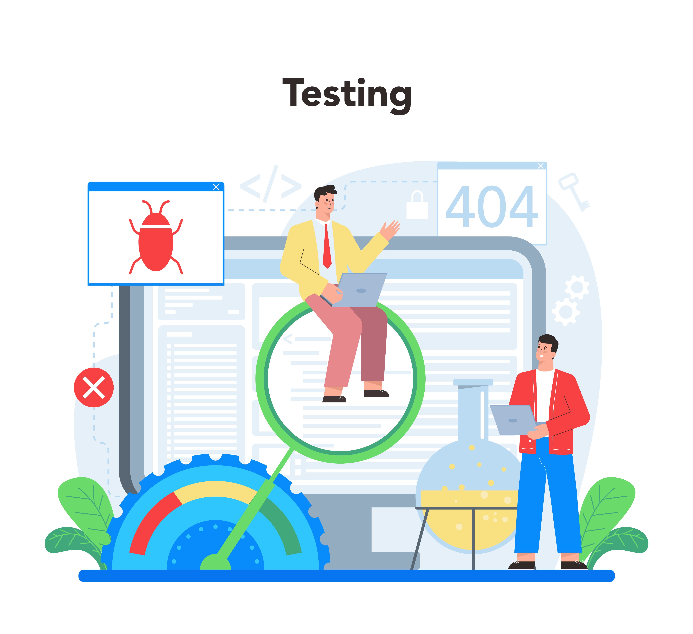

# Foco de Testes - Certificação - Wiki de QA - Desenvolvimento

## Docs e Wiki deste Repositório

Como este repositório se iniciou?

Explicação que era para reunir materiais para estudos sobre o que é testes......

---

## O que é esse Web/App?

Aplicativo Flutter para estudos da CTFL Foundation 4.0. Interface responsiva para web, Android e iOS/iPadOS, derivada do protótipo HTML.

## Executar

Execute os comandos a partir da raiz deste repositório.

Use Flutter 3.47.9. O arquivo `mise.toml` seleciona essa versão no projeto e configura o Chrome em `/usr/bin/google-chrome-stable`.

Se utiliza mise, prepare o ambiente com:

```bash
mise trust
mise install
```

```bash
flutter pub get
flutter run -d chrome
```

Para dispositivos Android conectados ou emuladores, execute `flutter devices` e `flutter run -d ID_DO_DISPOSITIVO`. Para iOS e iPadOS, use macOS com Xcode configurado.

## Validar

```bash
dart format --output=none --set-exit-if-changed lib test
flutter analyze
flutter test
python3 tool/build_web.py
flutter build apk --debug
```

## Lista de Outros Locais para Estudar

Essa lista é achados que achei interessante recomendar - nenhuma delas é oficial da [ISTQB](https://bstqb.online/index.php/sobre)

[Site Cobertura Completa de Todos os Exames de Certificação ISTQB®](https://mockexamnetwork.com/pt/)

[Site com Simulados e Metodologia para Estudo na Certificação selecionada em QA](https://ctfl-app.vercel.app/ctfl/hoje?tab=hoje&prova=ctfl)
[Repo ctfl-app](https://github.com/ironidesflj/ctfl-app)

[App Não-oficial Simulados Prova Foundation e mais](https://play.google.com/store/apps/details?id=com.estudo.istqbquiz&hl=pt_BR)

---

## Organização

- `lib/domain` contém questões, perfil e estado da tentativa em Dart. O cronômetro recebe o horário nas operações para permitir testes determinísticos.
- `lib/data` salva um snapshot versionado em SharedPreferences.
- `lib/app_controller.dart` coordena o ciclo de vida e serializa gravações para preservar a ordem das respostas.
- `lib/ui` contém telas e componentes responsivos.
- `assets/exams.json` mantém o conteúdo das questões separado da interface.
- `test` verifica correção, pausa, expiração e recuperação da tentativa.

A primeira resposta é definitiva após mostrar o gabarito. Café com leite permite pausar. Orgulho Bixo usa um prazo contínuo, inclusive ao fechar e reabrir o aplicativo. O perfil, a tentativa atual e o histórico dos treinos concluídos ficam salvos localmente, sem conta. A tela **Meu progresso** mostra resultados, datas e aproveitamento. A versão web mantém os dados no navegador utilizado.

Wi-Fi, modo avião e notificações são configurados pelo usuário no dispositivo. O banco de questões faz parte do aplicativo. Abrir o BSTQB exige conexão. O aplicativo oferece o aviso de redirecionamento antes de abrir o site.

## Conteúdo

Os treinos A e B contêm quatro questões autorais cada, conforme o protótipo. A ficha oficial informa 40 questões, 60 minutos padrão e 26 pontos para aprovação. O resultado da demonstração usa a quantidade real de questões.

Fonte oficial de conteúdo e provas de exemplo — [BSTQB CTFL](https://bstqb.online/ctfl).

Documentação do framework — [Flutter web](https://docs.flutter.dev/platform-integration/web/building) e [configuração de iOS](https://docs.flutter.dev/platform-integration/ios/setup).

## Instalar e usar offline

Gere o build PWA completo (Python 3 e Flutter):

```bash
python3 tool/build_web.py
python3 -m http.server 8765 --bind 127.0.0.1 --directory build/web
```

Abra `http://localhost:8765`, mantenha a conexão até aparecer **Pronto para estudar offline** e use a opção de instalar aplicativo do navegador. No Safari do iPhone/iPad, use **Compartilhar → Adicionar à Tela de Início**. Depois, feche e reabra o app sem conexão para conferir o funcionamento.

Para publicar, sirva todo o conteúdo de `build/web` por HTTPS. Se publicar em um subdiretório, gere com `python3 tool/build_web.py --base-href /nome-do-app/`. Mantenha o mesmo domínio e caminho entre versões. Configure o servidor para revalidar `service-worker.js` e `index.html` (`Cache-Control: no-cache`). O comando simples `flutter build web` não gera o cache offline deste projeto; use o script acima, também utilizado na CI. `flutter run -d chrome` é o ambiente de desenvolvimento e não valida o PWA release.

O script inclui os recursos do Flutter no próprio build, sem depender do CDN, e gera um cache identificado pelo conteúdo da versão. Uma atualização espera todas as janelas do app serem fechadas antes de assumir o controle. Ela substitui somente o cache dos arquivos do aplicativo, preservando o progresso local.

O primeiro acesso exige internet e espaço para baixar os recursos. O link externo do BSTQB continua exigindo conexão.

## Progresso local

- Perfil, respostas, marcações de revisão e estado do cronômetro são salvos automaticamente a cada alteração.
- Fechar e reabrir permite retomar a tentativa. O modo Café com leite deve ser pausado para congelar o tempo; Orgulho Bixo mantém o prazo contínuo.
- Cada treino concluído entra uma única vez no histórico, inclusive por expiração. Iniciar outro treino preserva os resultados anteriores.
- O formato antigo de armazenamento é migrado ao salvar. Para tentativas já concluídas antes da migração, a data registrada é a da primeira recuperação.
- No navegador, o armazenamento pertence ao mesmo endereço e perfil do navegador. A instalação usa o armazenamento desse contexto; outros navegadores ou dispositivos não recebem o progresso.
- Não há conta, envio para servidor ou sincronização. Limpar os dados do site/app apaga o progresso. Navegação privada e políticas do navegador também podem remover os dados. O app solicita armazenamento persistente quando o navegador permite, mas isso não equivale a um backup.

---

## Quality Assurance

Repositório serve para consultas centralizadas sobre Qualidade de Software.
Padrões de Documentos, links com referẽncias técnicas, artigos, entre outros, utilize como consulta, para estudos, aplicar no projeto que está atuando.



---

### 📚 Repositório QA

> Esse repositório serve para compartilhar alguns padrões de escrita de Casos de Testes, cadastro de BUGs e estruturar uma Suíte de Testes, também compartilhar um pouco de conhecimento no que apliquei em alguns projetos, e para ajudar QAs a compartilhar exemplo de portfóios no seu GitHub.

---

### Estrutura do Repositório 💼

- [Exemplo de Padrão de Documento de Testes](docs/documento-evidencias-de-testes.md)
- [Como padronizar Bugs](docs/bugs/)
- [Como organizar Casos de Testes utilizando escrita de testes BDD](docs/test-case/)

- [Exemplos de consultar SQL - BD Relacional](docs/consultar_sql/)

#### Estudos em Testes Automatizados

- [Testes automatizados com K6 em APIs](https://github.com/kellen-xavier/estudos_k6)

### Referencias

[QA in Production](https://martinfowler.com/articles/qa-in-production.html)
[Dev Ops Culture](https://martinfowler.com/bliki/DevOpsCulture.html)
