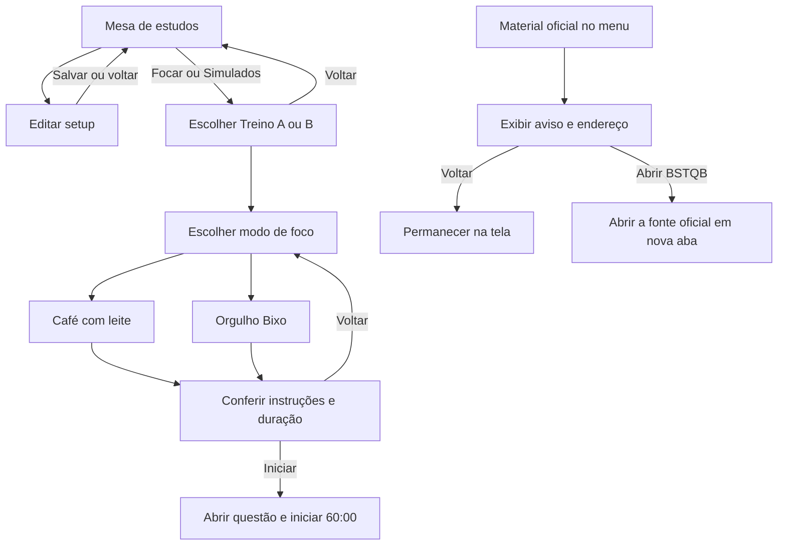
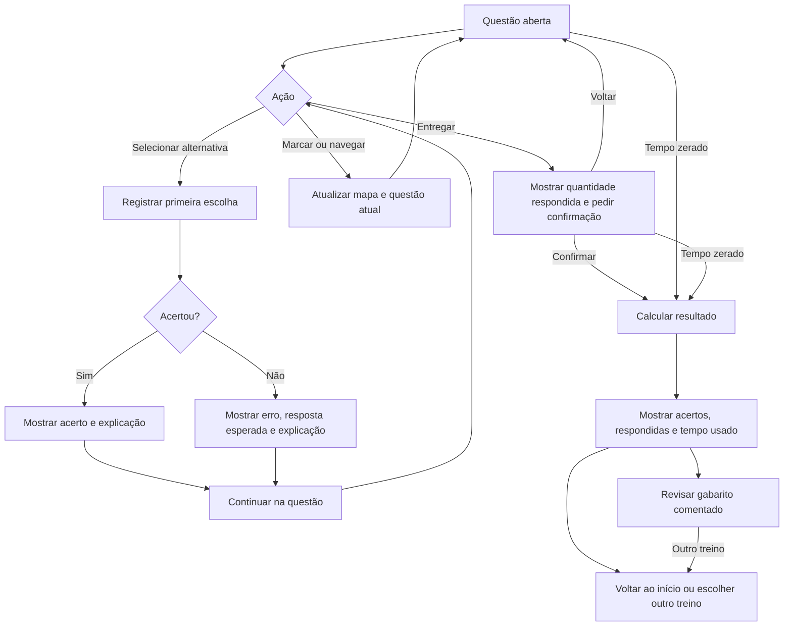
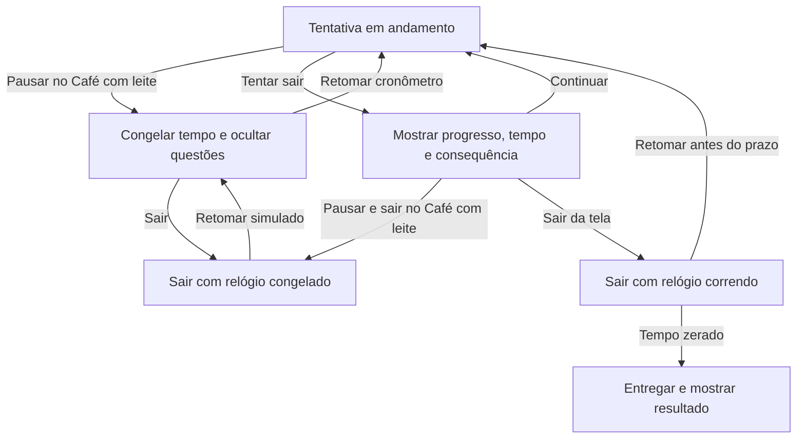

# Foco de Teste

## Conceito e fluxos do protótipo CTFL Foundation 4.0

### Proposta

Uma mesa de estudos personalizável que leva a uma tentativa cronometrada, com correção durante o treino e revisão ao final. O avatar é opcional. A certificação é fixa nesta etapa, então **Focar** abre diretamente os treinos A e B da CTFL Foundation 4.0. A interface reúne os dados oficiais em um único cartão e mantém a linguagem de estudo em todas as telas.

As capturas da primeira versão mostravam três cartões para a mesma certificação, uma etapa redundante de seleção da prova e um aviso de saída igual para qualquer tentativa. A revisão reúne a ficha em um cartão, troca a seleção de certificação pela escolha do modo e mostra as consequências reais de sair.

### Formato oficial e escopo da demonstração

O BSTQB informa **60 minutos padrão, 40 questões de múltipla escolha, 1 ponto por questão e 26 pontos para aprovação**. A ficha também descreve condições de acréscimo de tempo e a etapa de transcrição para o gabarito. O treino digital usa 60 minutos em ambos os modos e registra as respostas na tela. A distribuição oficial por capítulo é **8, 6, 4, 11, 9 e 2 questões**, respectivamente. [Ficha oficial, syllabus e provas de exemplo do BSTQB](https://bstqb.online/ctfl)

Cada treino do HTML contém quatro questões autorais para demonstrar as interações. A pontuação é exibida sobre quatro. Correção imediata, modos de foco e pausa são regras pedagógicas do produto. Os exemplos oficiais e seus gabaritos são acessados pelo menu **Material oficial**, com aviso e confirmação de abertura em nova aba.

### Modos de foco

| Regra | Café com leite | Orgulho Bixo |
| --- | --- | --- |
| Preparação no dispositivo | Manter Wi-Fi ligado e silenciar notificações | Ativar modo avião, desligar Wi-Fi e silenciar notificações |
| Cronômetro inicial | 60:00 | 60:00 |
| Durante o treino | Pausar e retomar na mesma questão | Contagem contínua |
| Ao sair da tela | Continuar, pausar e sair, ou sair com tempo correndo | Continuar ou sair com tempo correndo |
| Correção | Imediata após a primeira escolha | Imediata após a primeira escolha |
| Entrega | Por confirmação ou ao zerar | Por confirmação ou ao zerar |

As configurações de Wi-Fi, modo avião e notificações são feitas no dispositivo. O HTML é autocontido e o questionário funciona sem rede quando o arquivo está aberto. O acesso à página do BSTQB depende de conexão. A tentativa permanece disponível na mesma página durante a sessão. Atualizar ou fechar o arquivo pode interromper o treino.

### 1. Entrada, configuração e material oficial

### 2. Resposta, correção e entrega

### 3. Pausa, saída e retorno

### Comportamento e critérios de aceite

| Situação | Resposta da interface |
| --- | --- |
| Primeira escolha | Corrigir na mesma tela. Mostrar texto e ícone, destacar a alternativa esperada e levar o foco à correção. A primeira escolha fica registrada para preservar a pontuação após a revelação. |
| Navegar ou marcar | Permitir avançar, voltar, visitar pelo mapa e sinalizar questões para revisão, inclusive as em branco. |
| Café com leite pausado | Exibir o tempo congelado e o botão **Retomar cronômetro**. Mostrar as questões novamente ao retomar. O tempo usado exclui pausas. |
| Orgulho Bixo ativo | Exibir o relógio e manter o prazo correndo ao trocar de aba ou de tela. Ao voltar, recalcular pelo horário de término. |
| Sair | Usar a quantidade respondida e o tempo restante para dimensionar a decisão. Dar prioridade a **Continuar simulado** e oferecer **Pausar e sair** quando aplicável. |
| Entregar | Exigir confirmação manual ou entregar automaticamente ao expirar. Questões em branco aparecem na revisão. |
| Tela pequena | Empilhar questão e mapa, manter o cronômetro visível ao rolar e permitir operação por toque e teclado. |
| Material oficial | Exibir “Você será redirecionado para o site oficial do BSTQB” com o endereço e a ação **Abrir BSTQB**. |

### Melhorias para a próxima versão

1. **Banco completo de questões.** Montar uma tentativa de 40 questões pela distribuição oficial e registrar, para cada questão autoral, capítulo, objetivo de aprendizagem, alternativa correta e justificativa. Revisar o conteúdo com o syllabus antes de disponibilizar a tentativa completa.
2. **Recuperar após recarregar.** Salvar modo, prazo, questão atual e respostas da tentativa no dispositivo. Ao reabrir, retomar com o tempo preservado no Café com leite pausado ou encerrar pelo prazo original quando a contagem estiver ativa.
3. **Preparar para uso offline na versão hospedada.** Validar o carregamento local do banco e da interface antes de instruir a pessoa a desligar o Wi-Fi. Exibir um aviso claro se tentar abrir o BSTQB sem conexão.
4. **Validar acessibilidade e dispositivos.** Testar o foco após a resposta, a leitura do aviso de saída, o contraste das alternativas, o cronômetro no teclado e a navegação no iPad e no celular. Com 40 questões, avaliar um mapa recolhível em telas estreitas.
